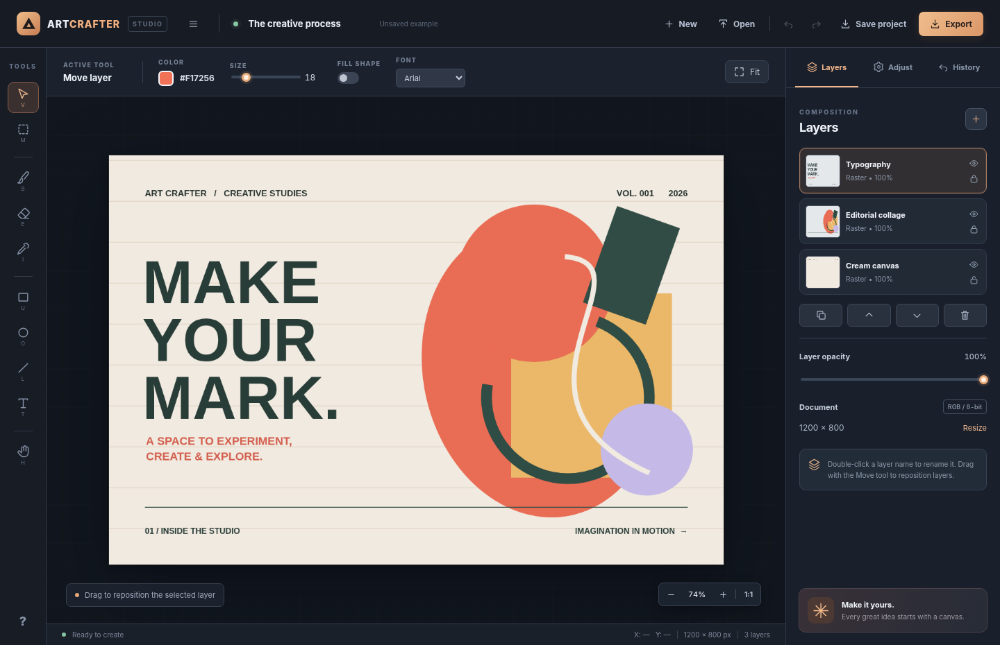

# Art Crafter

**A Photoshop-inspired browser-based raster image editor with independent pixel layers, drawing tools, non-destructive adjustments, and portable editable project files.**



Art Crafter is an original independent web app, **not affiliated with Adobe or Photoshop**. Built using HTML5 Canvas, vanilla JavaScript, and CSS with no runtime dependencies and no telemetry. It runs entirely in your browser: your images stay on your computer.

## Quick start

**Option A — easiest:** Open `index.html` in a modern browser (Chrome, Edge, Firefox). No installation or API keys required.

**Option B — local development:**

```bash
python -m http.server 8000
```

Then open [http://localhost:8000](http://localhost:8000). Sample artwork appears on the first load; select **New** for a blank canvas.

## Features

| Area | Capabilities |
| --- | --- |
| Raster layers | Create, name, duplicate, reorder, hide, lock, reposition, delete and adjust opacity |
| Tools | Brush, eraser, move, marquee rectangle, eyedropper, rectangle, ellipse, line, and text |
| Editing | Select, copy, paste into a new layer, delete selected pixels, crop to selection, zoom and pan |
| Adjustments | Per-layer brightness, contrast, saturation and blur with editable settings and three presets |
| Transformations | Rotate selected raster layer by 90°, flip horizontally and vertically |
| Images | Import PNG/JPEG/WebP/GIF from picker, drag and drop or clipboard paste |
| Export | Download flattened PNG (with transparency), JPEG or WebP |
| Projects | Save/open editable `.artcrafter.json` files with raster layers and filter settings |
| Workflow | Undo/redo history (up to 20 snapshots), keyboard shortcuts, fit-to-window, interactive layer thumbnails |
| UI | Dark-themed responsive editor, keyboard navigation, canvas dimensions and cursor coordinates |

### Keyboard shortcuts

`V` Move · `M` Selection · `B` Brush · `E` Eraser · `I` Eyedropper · `U` Rectangle · `O` Ellipse · `L` Line · `T` Text · `H` Hand · `Space` Temporary hand · `Ctrl/⌘+Z` Undo · `Ctrl/⌘+Shift+Z` Redo · `Ctrl/⌘+S` Save editable project · `Ctrl/⌘+O` Open · `Ctrl/⌘+C` Copy selection · `Ctrl/⌘+V` Paste selection · `Escape` Deselect · `Delete` Remove pixels within selection.

## Quality and safety

- Import restrictions: PNG/JPEG/WebP/GIF only, up to 30 MB; editable projects are validated before loading and capped at 120 MB.
- Canvas bounds: 64–4096 pixels per dimension; at most 40 imported raster layers.
- Image parsing, drawing, and exports happen **locally in the browser**, with no backend uploading content.
- Unit tests cover helper functions, selection geometry, image MIME types and HTML/JS integration; GitHub Actions runs the suite on every push.

Run tests (Node.js 20+):

```bash
npm test
```

## Architecture

- `index.html` — editor workspace, toolbar, layers panel, adjustments, dialogs and accessibility labels.
- `styles.css` — responsive dark UI, interactive states and canvas layout.
- `core.js` — dependency-free document bounds, filter, validation and selection helpers; exported for Node tests.
- `app.js` — document and layer model, Canvas 2D compositing, input events, history, project serialization and export.
- `tests/core.test.cjs` — automated unit checks and application integration assertions.

Each raster layer has its own offscreen canvas, offset, opacity, visibility state, lock state and filter properties. The main canvas composites visible layers in order; the overlay canvas draws selection and shape previews. State snapshots are serialized for undo/redo. Project files store metadata and PNG image data for each layer.

## Important limitations

This is a **functional, learning-oriented image editor**, not a complete Photoshop replacement: it does not support PSD files, vector paths, masks, smart objects, editable text objects, CMYK, Photoshop plugins, GPU tile rendering or multi-gigabyte professional assets. Text and shapes are rasterized into the selected layer when placed. Layer rotation clips to the canvas boundaries. Undo history is in-memory until the page closes; save an editable project for future sessions. Very large images or many snapshots may require substantial browser memory.

## Roadmap

Layer masks, richer selection transformations, typography editing, gesture controls, GPU accelerated filters, tiled rendering, PSD interoperability and integration/browser E2E testing.

## Portfolio context

This demonstrates front-end application engineering, Canvas 2D image processing, a multi-layer document model, serialization, undo/redo state management, defensive input validation, responsive interface design and automated unit testing.

**License:** MIT.
